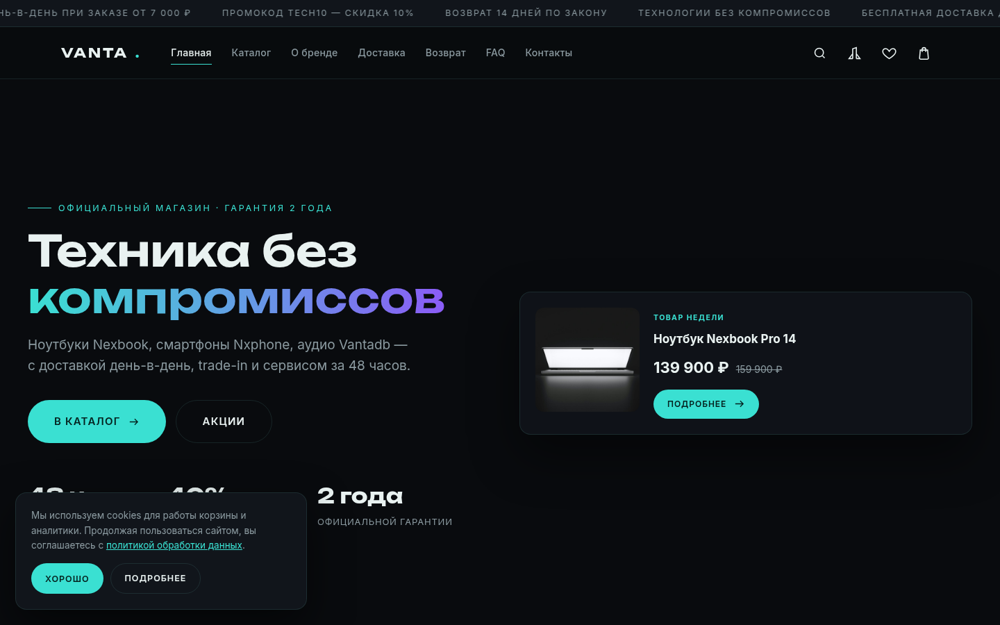
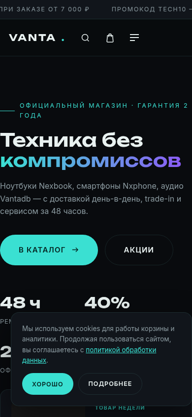

# VANTA — Электроника и гаджеты

## Демо

**[Открыть сайт →](https://shalim-andrej.github.io/vanta/)**

**VANTA — техника будущего**

Фирменный магазин электроники VANTA: официальная гарантия 2 года, доставка день-в-день, сервис в центре Москвы.

## Тип вёрстки
Tech-грид: плотная сетка, сравнение товаров, табы и бандлы

## Палитра и шрифты
- Тёмная премиум-тема, акцентный цвет — по нише (см. `css/style.css`, блок `:root`)
- Дисплейный и текстовый шрифт — вариативные woff2 с кириллицей, лежат локально в `assets/fonts/`

## Функционал (чистый JS, без зависимостей)
- Каталог с живыми фильтрами (chips), сортировка, «показать ещё»
- Карточка товара: галерея, цвета, размеры
- Корзина с localStorage, промокод `TECH10` (−10%), порог бесплатной доставки
- Чекаут с валидацией, выбором доставки и оплаты, экраном подтверждения заказа
- Избранное, сравнение товаров, живой поиск, модальные окна
- 22 товаров с описаниями, характеристиками и рейтингами
- Адаптив 360–1920, cookie-баннер, плавные reveal-анимации

## Страницы (16)
404.html, about.html, cart.html, catalog.html, checkout.html, compare.html, consent.html, contacts.html, delivery.html, faq.html, favorites.html, index.html, offer.html, privacy.html, product.html, returns.html

## Юридический пакет (РФ)
- `offer.html` — договор публичной оферты (ГК РФ ст. 435–438)
- `privacy.html` — политика обработки ПД (152-ФЗ)
- `consent.html` — согласие на обработку ПД (ст. 9 152-ФЗ)
- `returns.html` — правила возврата (ЗоЗПП, Постановление № 2463)
- Реквизиты продавца: ИП Соколов Артём Дмитриевич, ИНН 772645890132 (демо-данные)

## Запуск
Открыть `index.html` двойным кликом — сайт полностью офлайн.
